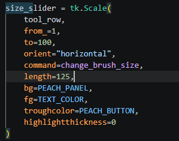
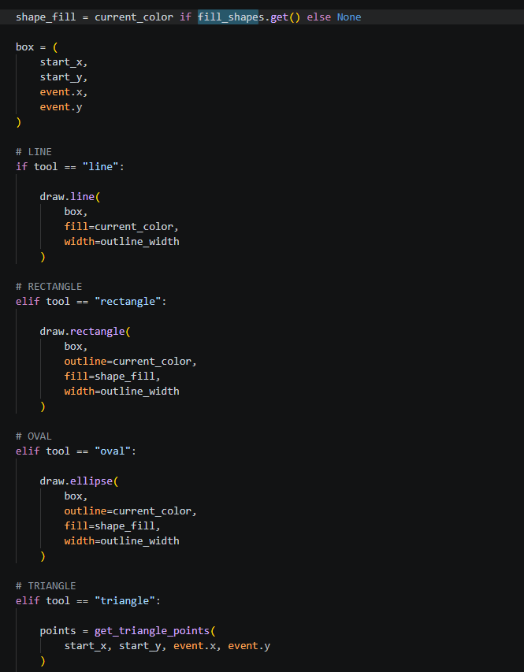
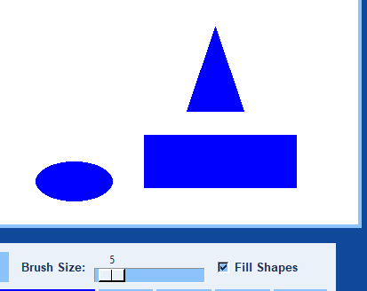
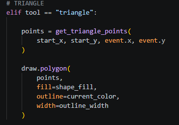
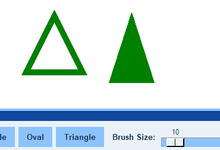
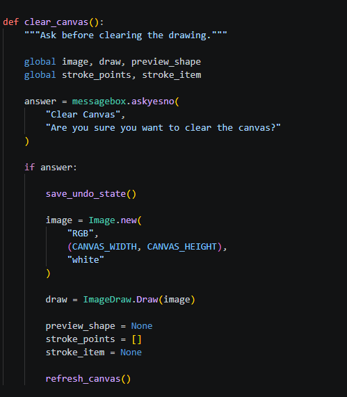

# Paint_Application

Name: Edito T. Capispisan Jr.
Section: BSINFOTECH SE 3-A

# Features Implemented

1. Bigger Brush Range – Increased the maximum brush size from 30 to 100.
2. Undo Button – Allows users to undo their most recent drawing action.
3. Filled Shapes – Allows users to fill rectangles, ovals, and triangles with color.
4. Triangle Tool – Added a tool for drawing triangles on the canvas.
5. Confirm Before Clearing – Displays a confirmation message before clearing the canvas.
6. Quick Colors – Added six color buttons: Black, Red, Blue, Green, Yellow, and Purple.
7. Customized UI Design – Improved the application's colors, buttons, and toolbar layout.
8. Undo Keyboard Shortcut – Added Ctrl + Z as a shortcut for undoing the most recent action.

# Description

This is my Paint Application project made using Python, Tkinter, and Pillow. I used the source code provided as my starting point and modified the existing application by adding new features and improving its design.

## REQUIREMENTS COMPLETED

### Whole UI Design

Here is the screenshot of my updated Paint Application, showing its overall design and available tools.

---

### ✓ 1. Bigger Brush Range

I changed the maximum brush size from 30 to 100. Before, users could only adjust the brush size from 1 to 30. Now, they can make the brush bigger or smaller depending on what they need when drawing.

**Original Code:**

**Updated Code:**

I changed the `to` value from `30` to `100` to increase the maximum brush size.

**Result:**

---

### ✓ 2. Undo Button

I added an Undo button so users can go back if they make a mistake while drawing. Before, there was no Undo feature.

To make this work, I added a function that saves a copy of the drawing before a new action starts. When the user clicks Undo, the application brings back the previous drawing. It works for both freehand drawings and shapes.

**Code:**

**Result:**

---

### ✓ 3. Filled Shapes

I added a Fill Shapes option that allows users to fill rectangles, ovals, and triangles with color. Before, the shapes could only be drawn with outlines.

I added a checkbox that lets users choose whether they want their shapes to be filled or just have an outline. When the checkbox is selected, the shape uses the current drawing color as its fill color.

**Fill Code:**

**Result:**

---

### ✓ 4. Triangle Tool

I added a Triangle Tool so users can draw triangles on the canvas. Before, the available shape tools were only Line, Rectangle, and Oval.

To use it, the user needs to select the Triangle button and drag the mouse to create the shape. A preview of the triangle appears while dragging. Once the mouse button is released, the triangle becomes part of the drawing and can also be saved.

**Code:**

**Result:**

---

### ✓ 5. Confirm Before Clearing

I updated the existing Clear function by adding a confirmation message. Before, clicking the Clear button would immediately erase everything on the canvas.

Now, a message appears asking the user if they really want to clear their drawing. There are two options: Yes and No. Choosing Yes will clear the canvas, while choosing No will keep the current drawing. This helps prevent users from accidentally deleting their work.

**Original Code:**

**Updated Code:**

**Result:**

---

### ✓ 6. Quick Colors

I added Quick Colors buttons to make choosing colors easier. Before, users had to click Choose Color and select a color from the color picker.

Now, they can simply click one of the six color buttons on the toolbar: Black, Red, Blue, Green, Yellow, or Purple. Clicking a button immediately changes the drawing color.

**Updated Code:**

**Result:**

---

## Other Improvements

I also added a keyboard shortcut for the Undo feature. Users can press **Ctrl + Z** to undo their most recent drawing action instead of clicking the Undo button every time.

---

## Canvas and Saved Image

I used Pillow to handle the drawing and saving of images. The canvas and the image used by Pillow both have the same size of **900 × 550 pixels**.

When users save their drawing, the application saves the Pillow image. This helps make sure that the saved image matches the drawing shown on the canvas.

---

