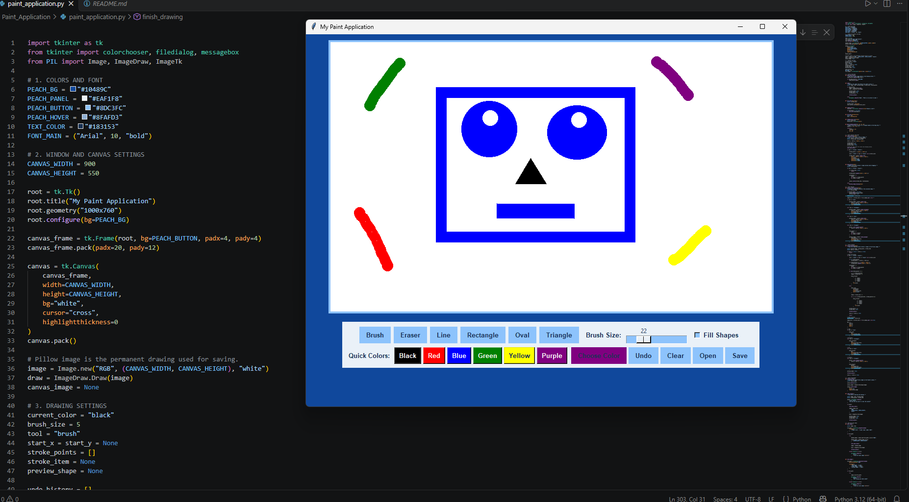

# Paint_Application

## REQUIREMENTS COMPLETED:

Whole UI Design:

### ✓ Bigger Brush Range

What I did here was increase the maximum brush size from 30 to 100. Originally, the brush size slider only allowed users to select a value between 1 and 30. I changed the maximum value to 100 so users can draw with thicker brush strokes.

Original Code:

To increase the brush size range, I simply changed the `to` value from `30` to `100`.
new_brush_range.png

Updated Code:

**Result:**

