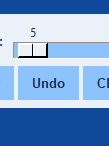
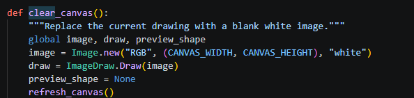
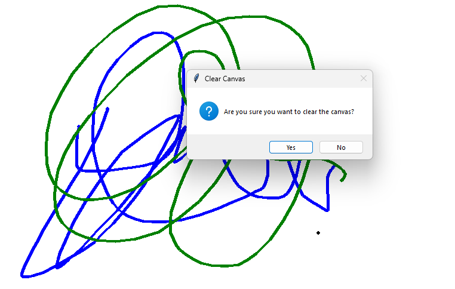
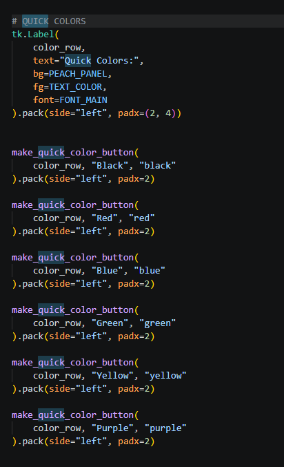

# Paint_Application

## REQUIREMENTS COMPLETED:

### Whole UI Design:

### ✓ Bigger Brush Range

I changed the maximum brush size from 30 to 100. Before, users could only adjust the brush size from 1 to 30. Now, they can make the brush bigger or smaller depending on what they need when drawing.

**Original Code:**

**Updated Code:**

I changed the `to` value from `30` to `100` to increase the maximum brush size.

**Result:**

---

### ✓ Undo Button

I added an Undo button so users can go back if they make a mistake while drawing. Before, there was no Undo feature, so users couldn't easily bring back their previous drawing after making changes.

**Code:**

**Result:**

---

### ✓ Filled Shapes

I added a Fill Shapes option that allows users to fill rectangles, ovals, and triangles with color. Before, the shapes could only be drawn with outlines. Now, users can choose whether they want their shapes filled or not.

**Fill Code:**

**Result:**

---

### ✓ Triangle Tool

I added a Triangle Tool so users can draw triangles on the canvas. They just need to select the Triangle button and drag their mouse to create the shape. Before, the available shapes were only line, rectangle, and oval.

**Code:**

**Result:**

---

### ✓ Confirm Before Clearing

I updated the existing Clear function by adding a confirmation message. Before, clicking the Clear button would immediately erase everything on the canvas. Now, a message will appear asking the user if they really want to clear their drawing. This helps avoid accidentally deleting their work.

**Original Code:**

**Updated Code:**

**Result:**

---

### ✓ Quick Colors

I added Quick Colors buttons to make choosing colors easier. Before, users had to click Choose Color and select a color from the color picker. Now, they can simply click a color button on the toolbar to choose Black, Red, Blue, Green, Yellow, or Purple.

**Updated Code:**

**Result:**

