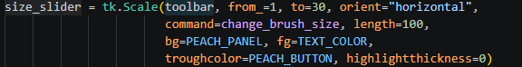
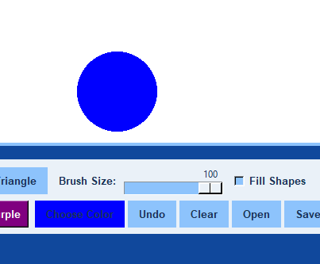
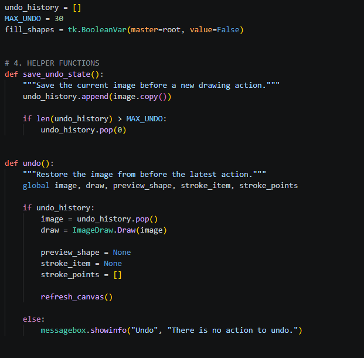
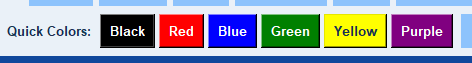

# Paint_Application

## REQUIREMENTS COMPLETED:

Whole UI Design:

### ✓ Bigger Brush Range

What I did here was increase the maximum brush size from 30 to 100. Originally, the brush size slider only allowed users to select a value between 1 and 30. I changed the maximum value to 100 so users can draw with thicker brush strokes.

**Original Code:**

To increase the brush size range, I simply changed the `to` value from `30` to `100`.
new_brush_range.png

**Updated Code:**

**Result:**

### ✓ Undo Button

I added an Undo button so that users can reverse their most recent drawing action. This feature was not available in the original application. With this improvement, users can easily undo a drawing if they make a mistake without having to clear the entire canvas.

**Code:**

**Result:**

### ✓ Filled Shapes

I added a feature that allows users to create filled shapes instead of drawing only their outlines. Users can now draw solid rectangles and ovals, making the drawing application more useful and flexible.

**Fill Code:**

**Result:**

### ✓ Triangle Tool

I added a Triangle Tool that allows users to draw triangle shapes on the canvas. Users can select the Triangle button and drag their mouse to create a triangle. This gives users another shape option aside from lines, rectangles, and ovals.

**Code:**

**Result:**

### ✓ Confirm Before Clearing

**Example:**

I improved the existing Clear function by adding a confirmation dialog before removing the drawing. In the original application, clicking the Clear button immediately erased everything on the canvas. I added a confirmation message asking users if they really want to clear their drawing. This helps prevent accidental deletion.

**Original Code:**

**Updated Code:**

**Result:**

### ✓ Quick Colors

I added Quick Colors buttons to make color selection easier and faster. In the original application, users had to click the Choose Color button and select a color from the color picker. With this improvement, users can now select commonly used colors directly from the toolbar, such as Black, Red, Blue, Green, Yellow, and Purple.

**Updated Code:**

**Result:**

